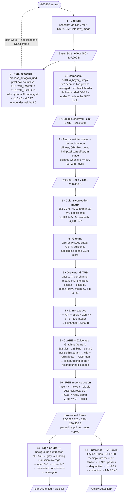

# Alif Board — Image Processing Flow

What happens to one frame on the Alif Ensemble (RTSS-HE, Cortex-M55 +
Ethos-U55): **capture → pre-processing (ISP) → Sign-of-Life → inference**.

Entry point: `sensing_task()` — `source/use_case/pg_object_detection/src/sensing.cc:89`,
which calls `hal_get_image_data(320, 240)` and then hands the resulting pointer
to the Sign-of-Life detector and to the network.

Reference build: `alif-gcc-he-revB`, `yolov8-tiny` int8, `ENABLE_CLAHE_PROCESSING=ON`,
`ENABLE_HM0360_QVGA=OFF` (sensor at VGA 640×480), `SOL_SHADOW_VETO=OFF`.

Two geometries are in play: `CIMAGE_X×CIMAGE_Y` = **sensor** = 640×480 (or
320×240 with `--qvga`); `IMAGE_X×IMAGE_Y` = **processing** = fixed 320×240
(`image_processing.h:22,26`).

---

## 1. The pipeline



Steps 1–10 are `get_image_data()`
(`source/hal/source/components/image/source/ensemble/image_ensemble.c:242`),
all CPU-side, Helium/MVE where available. Steps 4–10 all operate **in place** on
the same buffer.

Note the order: **the resize happens before white balance**, so colour
correction, gray-world and CLAHE all run on the downscaled 320×240 frame.

---

## 2. Pre-processing steps in detail

| # | Step | Algorithm | In → Out | Code |
| --- | --- | --- | --- | --- |
| 1 | Capture | snapshot mode, CPI/MIPI CSI-2 DMA straight into `raw_image`; D-cache invalidated afterwards because the DMA wrote around it | sensor → Bayer 640×480 | `image_ensemble.c:261` |
| 2 | Auto-exposure | pixel-pair counting against `THRESH_LOW 30` / `THRESH_HIGH 215`, reduced to two proportions (high/low, over/under-exposed weighted ×4), then a **velocity-form PI controller** on log-gain with a `2^-4` dead-band, clamped to gain limits discovered from the driver | Bayer plane → one `camera_gain()` write | `:133, :312` |
| 3 | Demosaic | libdc1394 "Simple": 2×2 nearest neighbour, the two greens averaged, black 1-px border. The Helium asm/intrinsic variants are `__ARMCC_VERSION`-gated, so the **GCC build runs the scalar C path** | Bayer 640×480 → RGB888 640×480 | `bayer2rgb.c:78` |
| 4 | Resize | bilinear, Q14 fixed point (`FRAC_BITS 14`), half-pixel start offset to avoid dropping pixels on integer downsampling; in place (the destination pointer always trails the source). Early-out when source and destination geometry match; `abort()` if the integer scale ratios differ per axis | RGB888 640×480 → 320×240 | `image_processing.c:76,198` |
| 5 | CCM | 3×3 matrix, HM0360 manual-WB coefficients (marked `TODO: finetune`). MVE build uses `bulk_color_correction` (fp16, 8 px/iteration); scalar fallback is per-pixel fp32 | 320×240×3 → same | `color_correction.c:119,268` |
| 6 | Gamma | 256-entry LUT of the sRGB OETF, built once on first call, applied as the CCM writes each channel | — | `color_correction.c:197` |
| 7 | Gray-world | assumes the scene averages to neutral grey: two full-frame passes, means then per-channel scaling | 320×240×3 → same | `color_correction.c:216` |
| 8 | Luma extract | BT.601 integer approximation into a static `l_channel[320*240]`. CLAHE is applied to luma, not to Lab L\* — the source states the trade-off (Lab needs `pow()` and doubles, 10–50× slower on Cortex-M) | RGB → 8-bit luma plane | `image_processing.c:270,333` |
| 9 | CLAHE | per tile: histogram → clip at `3.0·(40·30)/128 = 28` with excess redistribution → cumulative map rescaled to \[0,255]. Then a `(8+1)×(8+1)` bilinear sweep blends the four surrounding tile maps per pixel, which is what removes tile-boundary artefacts. Needs `320 % 8 == 0` and `240 % 8 == 0`, else it errors out and the frame is dropped | luma → equalised luma | `clahe.c:48` |
| 10 | RGB reconstruction | `ratio_q12 = Y'_new · inv_q12[Y'_old]` with `inv_q12[i] = 4096/i` (512 B LUT), then `C' = clamp((C·ratio)>>12)`. Preserves hue reasonably; avoids a per-pixel division | luma ratio + original RGB → RGB | `image_processing.c:404` |

### `white_balance()` — steps 5–7 are one call

```c
white_balance(w, h, sp, dp)          /* called with sp == dp — in place */
  ├─ prepare_gamma_lut()             /* 256 B, sRGB OETF, built once    */
  ├─ bulk_color_correction(sp,dp,…)  /* CCM, gamma applied on store     */
  │     R' = lut[ C_RR·R + C_GR·G + C_BR·B ]
  │     G' = lut[ C_RG·R + C_GG·G + C_BG·B ]
  │     B' = lut[ C_RB·R + C_GB·G + C_BB·B ]
  └─ gray_world(sp, dp, len)         /* two passes over the whole frame */
        mean_gray = (mean_r + mean_g + mean_b) / 3
        C' = clip( C · mean_gray / mean_C , 255 )
```

```
        R      G      B          (color_correction.c:61)
R'   +1.86  +0.00  -0.05
G'   -0.16  +0.95  -0.53
B'   -0.53  +0.07  +2.27
```

Two consequences that are easy to miss:

* **Gray-world runs on gamma-encoded data**, not on linear light — it is the
  last statement of `white_balance()`, after the LUT has been applied.
* **Gray-world re-reads `sp`.** That is only correct because the caller passes
  `sp == dp`. With distinct buffers the CCM output would be discarded and
  gray-world would scale the raw input instead.

---

## 3. Sign-of-Life (step 11)

`sol::Pipeline::Process` — `SolPipeline.cc:35`. Runs on the processed frame,
read-only, **before** the network. Parameters are the `PipelineConfig`
defaults (`SolTypes.hpp:80`).

| Layer | Step | Algorithm | Params |
| --- | --- | --- | --- |
| 0 | denoise | separable **Gaussian blur**, reflect-101 border, σ derived from ksize as OpenCV does; rolling 5-row float ring instead of a full float image | 5×5 |
| 1 | feature | **RGB→Gray**, BT.601 fixed point `4899/9617/1868 >> 14` — bit-identical to `cv2.RGB2GRAY` | — |
| 1 | model | **Running Gaussian Average** (Wren / bgslibrary): per-pixel mean + variance, foreground if `(x−μ)² > 12.25·σ²`; selective update (background pixels only) after a 30-frame learn-in; variance clamped to \[4, 180] | α 0.1, thr 3.5², init var 36 |
| 2 | shadow veto | HSV shadow suppression + EW RGB reference — **compiled out** (`SOL_SHADOW_VETO=OFF`) | — |
| 3 | open | erode ∘ dilate, elliptical SE | 3×3 |
| 3 | close | dilate ∘ erode, elliptical SE | 7×7 |
| 3 | labelling | two-pass **connected components**, Rosenfeld union-find with path compression | 8-connectivity, cap 4096 |
| 3 | gating | keep blobs with `area ≥ 150`, sort descending; **Sign-of-Life = any blob ≥ 500 px** | — |

Outputs the flag, the blob list (bbox, area, centroid), the raw mask
(post-model, pre-morphology) and the filtered mask (area-gated labels only).
`sensing.cc` currently consumes only the flag and the blob list.

---

## 4. Inference (step 12)

`DetectionModel::RunDetection(image, 230400, dets)` — `DetectionModel.cc:82`.

| # | Step | Detail |
| --- | --- | --- |
| C1 | pre-process | `memcpy` of 230,400 B into the arena-resident input tensor. `ConvertImgToInt8` is skipped — this backbone's input is uint8. The copy is unavoidable: the Ethos-U addresses every tensor as an offset from the arena base, so the frame in SRAM1 cannot be handed to the NPU by pointer |
| C2 | inference | TFLite-Micro + Ethos-U55 H128, `Shared_Sram`. 306 operators fused by Vela into **2 NPU passes**; weights streamed from MRAM, feature maps in SRAM0. Vela estimate 48.36 ms at 500 MHz |
| C3a | dequantise | `(u8 − zero_point)·scale` into float vectors — outputs are `1×2100×1` (confidence) and `1×2100×6` (box + position). 2100 anchors = 40²+20²+10², the YOLOv8 P3/P4/P5 strides at 320×320 |
| C3b–c | class + gate | `max_element` over `numClasses` (= 1); drop below confidence **0.2** |
| C3d | correction | ridge-regression geometry correction, 6 outputs × 7 coefficients; the CLAHE-model coefficient set is selected at compile time |
| C3e | scaling | `× m_scaleFactor` = 1.0 — no-op, so boxes come out in 320×320 coordinates |
| C3f | NMS | greedy IoU NMS at **0.45**, OpenCV `NMSFast` port |

`PresentInferenceResult` prints the boxes and sets the sleep policy's "had
detection" flag at confidence **≥ 0.5** — a different threshold from the 0.2
post-process gate.

---

## 5. Observations

Ordered by how much they affect the image that reaches the model.

1. **The Bayer tile is hard-coded, and disagrees with the rev-selection macro.**
   `image_ensemble.c:64` defines `BAYER_FORMAT` as `BGGR` for rev-A silicon and
   `GRBG` otherwise, but the call at `:329` passes the literal
   `DC1394_COLOR_FILTER_BGGR`. In the rev-B build the macro would select `GRBG`;
   it is in fact referenced only by the disabled `FAKE_CAMERA` pattern
   generator. `BGGR` vs `GRBG` is an R↔B swap plus a green phase shift. Source
   alone cannot say which one the hardware needs — but the CCM was tuned
   empirically on top of the current path, so the two must be evaluated
   together, not separately.
2. **The auto-exposure correction lands on the next frame, and the controller
   state does not survive a boot.** Step 2 runs after the frame is already
   captured, so `camera_gain()` affects the *following* capture.
   `current_log_gain` and `previous_error` are `static` in `.bss`, which CRT0
   re-zeroes on every cold boot. With one inference per boot cycle in
   `MODE_OPERATIONAL` the PI loop never accumulates — each frame is exposed at
   whatever gain the sensor powers up with. Same structural problem as the
   Sign-of-Life background model losing its state across boots.
3. **Two independent exposure statistics exist; only one is used.**
   `bayer2rgb.c:72` carries its own `THRESH_LOW 9` / `THRESH_HIGH 173` and
   exports `exposure_{over,high,low,under}_count`. The autogain path never reads
   them — it recomputes its own counts with `30` / `215`. The counters are still
   computed in the scalar debayer loop every frame, and the comment at
   `image_ensemble.c:310` ("Use pixel analysis from bayer_to_RGB to adjust
   gain") is stale.
4. **White balance runs after the resize.** The AWB channel means are computed
   over 76,800 already-interpolated pixels. Cheaper than doing it at VGA, but
   the bilinear resize has averaged out exactly the saturated highlights and
   crushed shadows that gray-world is most sensitive to. Worth measuring before
   assuming the order is free.
5. **`white_balance()` is only correct in place** (§2). The single call site
   passes `sp == dp`, so this is latent, not live.
6. **CLAHE mallocs 32,768 B per frame** (`8·8·128·4`) on a 172,032 B DTCM heap,
   inside `CLAHE()`. Fixed size and freed before return, but it is the only
   allocation on the ISP path; a static buffer would remove it.
7. **The model input is 320×320 while the frame is 320×240.** `sensing.cc`
   passes 230,400 B into a 307,200 B tensor, so rows 240–319 are never written
   by the application. They are zero today because each boot runs one inference
   into a freshly zeroed arena; with more than one inference per boot they
   become stale NPU intermediate data, since Vela's offline plan places
   `scratch` at the same arena offset as the input tensor.
8. **Sensor-side vs host-side scaling are not equivalent.** With `--qvga` the
   sensor sub-samples to 320×240 and step 4 disappears entirely. The images then
   differ from the VGA path not only in resolution but in the resampling kernel
   — Sub2 sensor sub-sampling instead of a Q14 bilinear with a half-pixel
   offset. A dataset captured in one mode is not directly comparable to the
   other.

---

## 6. File index

| Concern | File |
| --- | --- |
| Entry point, frame hand-off to SoL and the network | `source/use_case/pg_object_detection/src/sensing.cc:89` |
| Capture + ISP orchestration (steps 1–10) | `source/hal/source/components/image/source/ensemble/image_ensemble.c:242` |
| Camera driver wrapper | `.../ensemble/src/camera.c:165` |
| Demosaic | `.../ensemble/src/bayer2rgb.c:78` |
| Resize, luma extract, CLAHE wrapper, reciprocal LUT | `.../ensemble/src/image_processing.c:76,198,333` |
| CLAHE core (Zuiderveld) | `.../ensemble/src/clahe.c:48` |
| CCM, gamma LUT, gray-world | `.../ensemble/src/color_correction.c:119,197,216,268` |
| Geometry macros `CIMAGE_*` / `IMAGE_*` | `.../ensemble/include/image_processing.h:22,26` |
| Sensor geometry / QVGA switch | `source/hal/source/platform/ensemble/cmsis-pack/config-b/RTE_Device.h:461` |
| Sign-of-Life pipeline / parameters | `.../pg_object_detection/src/SolPipeline.cc:35`, `.../include/SolTypes.hpp:80` |
| SoL operators (blur/gray/morph/CCL), background model | `.../src/NativeOps.cc`, `.../src/BackgroundModel.cc` |
| NN pipeline / pre / post | `.../src/DetectionModel.cc:82`, `.../src/DetectorPreProcessing.cc:29`, `.../src/DetectorPostProcessing.cc` |
| Memory-budget companion doc | `rtos_sensor/projects/alif_ml-embedded-evaluation-kit_pg/people_detection_flow_analysis.md` (firmware repo) |
