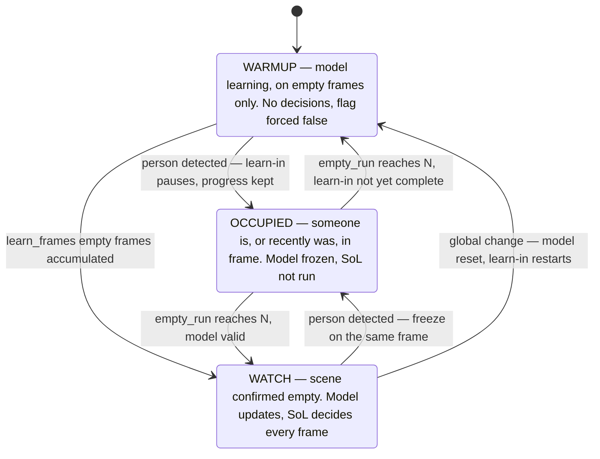
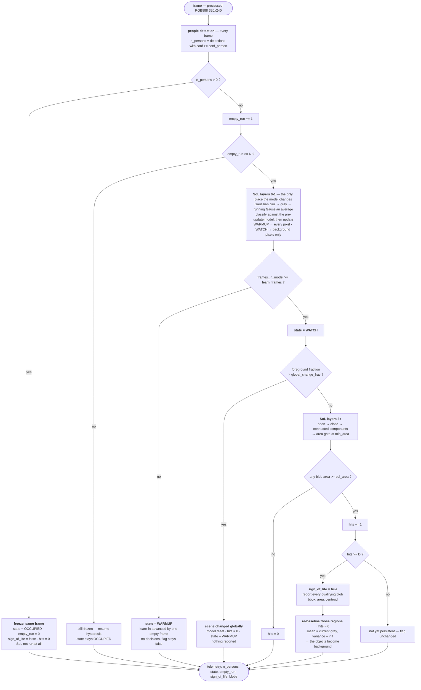
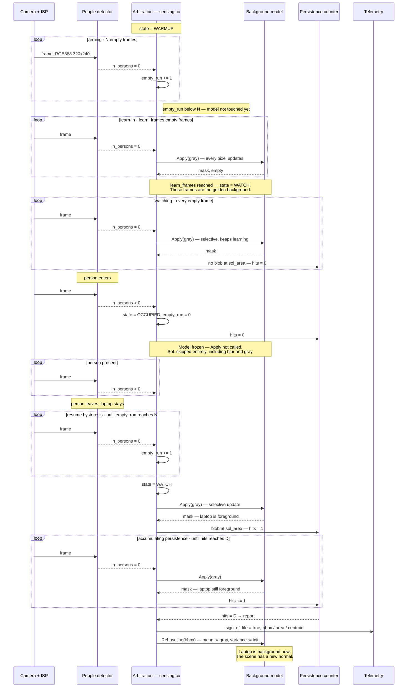

# Sign-of-Life ↔ People-Detection — Baseline Flow

How the people detector and the Sign-of-Life (SoL) background-subtraction stage
hand off to each other, per frame.

Rationale, measurements, failure modes, deferred work and the ideal-world
variants are in **`sol_people_detection_rationale.md`**. Alignment with the
firmware as built is in **`sol_baseline_alignment_report.md`**. This document is
the flow only.

> ### The whole design is stateful, and the state must persist across frames
>
> Nothing here works on a single frame in isolation. Every rule below reads or
> writes state carried from earlier frames, and **in `MODE_OPERATIONAL` each
> frame is a separate cold boot** — the subsystem is power-cycled between wakes
> and `.bss.sram0` is re-zeroed, so today none of it survives.
>
> | What must persist | Size | Home |
> | --- | --- | --- |
> | `empty_run`, `frames_in_model`, `hits`, `state` | ~16 B | **fits** the existing 4 KB retained region (`backup_4k_t`, `uint32_t` fields only) |
> | **Background model** — per-pixel `mean` + `variance` | **614,656 B** @ QVGA | **no home** — 150× the retained region |
> | reported-region bookkeeping, if delayed commit is added later | tens of bytes | retained region |
>
> The counters can be made wake-persistent today; the model cannot. Until it is,
> the machine never leaves `WARMUP` and nothing below runs. This is the one
> blocker — see §7.

---

## 1. Rules

1. **People detection runs on every frame.** Its output is the only input to the
   state machine, which needs the detection *count*, not the boxes.
2. **The background model updates only while the scene is confirmed empty** —
   `n_persons == 0` for `N` consecutive frames. While anyone is in frame the
   model is frozen whole and SoL does not run at all.
3. **Whatever the scene contains when learning completes is the background.**
   The sensor is commissioned on a clean scene; that is the installer's
   responsibility. Anything already present is background and is never reported.
4. **`learn_frames` is a floor, not a window.** It is the minimum number of
   empty frames before decisions may start — not the end of learning. The model
   keeps updating on *every* empty frame for the life of the session and keeps
   converging as it goes; only the initial all-pixel phase ends at
   `learn_frames`.
5. **Freezing is immediate, resuming is not.** A single frame with a person
   freezes the model on that same frame; resuming takes `N` consecutive empty
   frames. Freezing is a pause — learn-in progress and the model are kept.
6. **A left object never decays.** The update is selective (foreground pixels
   are never updated), so an object stays foreground until it is deliberately
   folded back in by a re-baseline after it has been reported. Because it also
   never moves, persistence needs a counter, not a tracker — no IoU association,
   no track identity.
7. **`sign_of_life` means: the scene contains content the people detector does
   not explain.** A left object raises it; so does a person the detector has
   been missing for `N` frames.

---

## 2. Definitions

| Name | Meaning |
| --- | --- |
| `n_persons` | detections with `confidence ≥ conf_person` |
| **empty frame** | `n_persons == 0` |
| `empty_run` | consecutive empty frames, including now |
| `blobs[]` | SoL regions surviving `min_area` |
| `hits` | consecutive frames on which *some* blob reached `sol_area` |
| `sign_of_life` | edge — fires once per newly appeared object |

---

## 3. States



| State | Model | SoL layers | `sign_of_life` |
| --- | --- | --- | --- |
| `WARMUP` | updates **all** pixels | 0–1 only | forced `false` |
| `OCCUPIED` | **frozen — not called** | none | cleared on entry |
| `WATCH` | **keeps learning** — every empty frame, selective | all | set when `hits` reaches `D` |

**Learning does not stop at `WATCH`.** That transition marks the first frame on
which a decision is *allowed*, nothing more. Every empty frame after it still
updates the model — selectively, so a left object is preserved — and the
variance keeps tightening toward the noise floor. A model 100 frames into a
quiet room is materially better than one at frame 5, and no state change marks
the difference; `frames_in_model` is what reports it.

---

## 4. Per-frame flow



**The state is derived, never stored.** It is a function of `n_persons`,
`empty_run` and `frames_in_model` — which is why the learn-in test is
`frames_in_model >= learn_frames` and not `state == WARMUP`. Testing the state
name would be a bug: an occupancy sets `OCCUPIED`, and nothing would ever set
`WARMUP` back, so an interrupted learn-in would silently start making decisions
on a half-built model.

---

## 5. Sequence of one full cycle

A person arrives, works, leaves and forgets a laptop. Phase lengths are given as
parameters, not frame counts — see §6.



| Phase | Length | What happens |
| --- | --- | --- |
| arming | `N` empty frames | `empty_run` climbs to `N`; the model is not touched |
| learn-in | `learn_frames` empty frames | all-pixel update — this frame set *is* the golden background |
| watching | until a person appears | SoL decides on every empty frame. The model is not finished: it keeps learning and gets more sensitive as it goes |
| occupied | while anyone is in frame | frozen on the first detected frame. The desk keeps its pre-arrival reference |
| resume hysteresis | `N` empty frames | still frozen; a short detector dropout does not resume it |
| persistence | `D` empty frames | the laptop is foreground from the first `WATCH` frame; `hits` climbs to `D` |
| report | 1 frame | `sign_of_life = true`, blobs reported, regions re-baselined |

Two latencies fall out:

```
time to a usable model   = ( N + learn_frames ) × wake_period
detection after departure = ( N + D )           × wake_period
```

The deployed `wake_period` is **10 s** (≈ 0.1 fps) — a firmware setting, not a
tuning parameter: `Production.h:75`, `sleep_policy.cc:26`.

---

## 6. Parameters

**Values are deliberately omitted — the research that fixes them is in
progress.** This table is the list of knobs, what each one controls, and what
will settle it. Current implemented defaults live in `sol::PipelineConfig`
(`SolTypes.hpp`); proposed starting points and the reasoning behind them are in
`sol_people_detection_rationale.md` §7, and should be treated as provisional.

| Symbol | Controls | Fixed by |
| --- | --- | --- |
| `conf_person` | which detections count as a person, and so when the model freezes | dropout **and hard-negative** rates from the 20-case eval suite — it is a two-sided trade (rationale §3.1) |
| `N` | resume hysteresis — empty frames required before unfreezing | detector flicker / dropout statistics |
| `learn_frames` | minimum empty frames before decisions start. A floor, not a window | M1 |
| `α` | background learning rate | M1, M5 |
| `min_area` | smallest blob kept by the area gate | M8 |
| `sol_area` | smallest blob that may raise the flag — the sensitivity floor | **M8** (TC-SOL-03: is a mug above it at QVGA?) |
| `D` | consecutive frames a blob must persist before reporting | M4 |
| `global_change_frac` | foreground fraction above which a frame is a changed scene, not objects | M6 (TC-SOL-06/07) |
| blur / open / close kernels | denoise and morphology, inherited from the SoL pipeline | existing BGS evaluation |

All of these are pixel- or frame-counted at the working resolution and cadence,
so any change to either silently retunes the detector.

---

## 7. Status

Not yet built, in the order they block each other:

1. **The background model does not survive a wake.** `.bss.sram0` is re-zeroed
   on every STOP cycle, so the model is rebuilt from frame 1 every 10 s and
   never leaves `WARMUP`. Everything below is moot until this is solved. The
   arbitration scalars fit the existing 4 KB retained region; the 614,656 B
   model does not.
2. **No persistence check on target** — `signOfLife` is a bare per-frame area
   test. The counter above is ~5 lines in `sensing.cc`; the full IoU-association
   FSM from `scr/fsm.py` is *not* needed unless per-object dwell is wanted
   later (rationale §9.5).
3. **No `Rebaseline`**, and no path for the SoL result to leave `sensing.cc`.

What already fits with no change: `BackgroundModel::Apply`, `Pipeline::Process`,
`SignOfLifeDetector::Reset()`. Details and costs in
`sol_baseline_alignment_report.md`.
