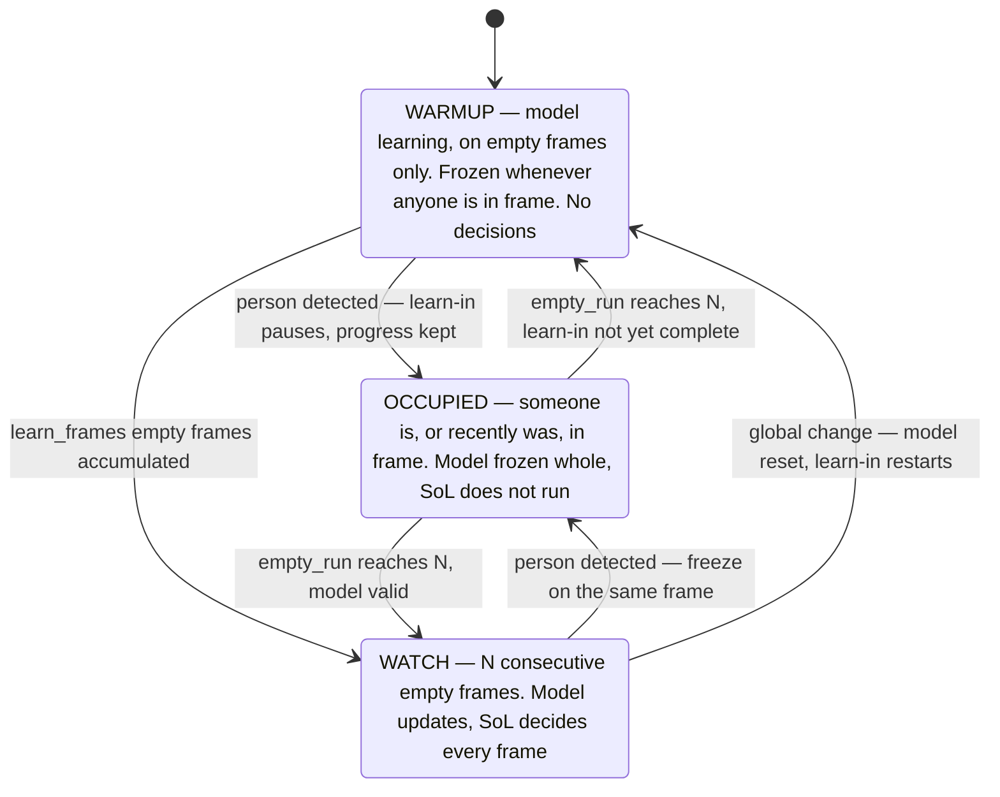
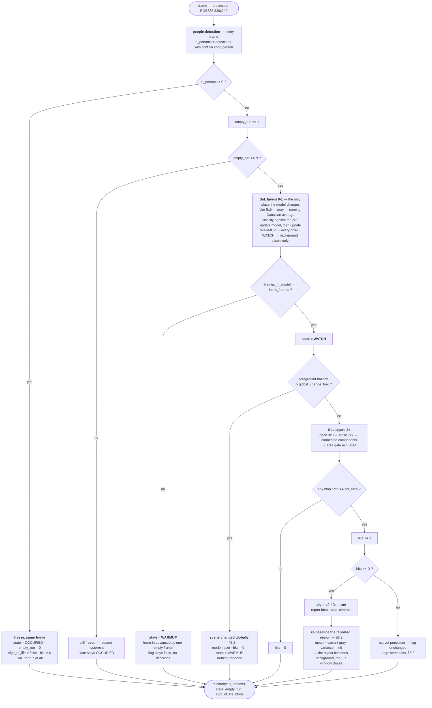

# Sign-of-Life ↔ People-Detection — Rationale and Analysis

**Companion to `sol_people_detection_baseline.md`**, which carries the rules,
the flow diagrams and the timeline. This document holds the reasoning behind
them: why each rule is shaped the way it is, the measurements and simulations,
the rejected alternatives, the failure modes, the deferred work and the open
questions. Read the baseline first; come here for *why*.

---

## 1. The requested rule, and what it implies

> Run people detection on every frame. If N consecutive frames show no people,
> run SoL to determine whether anything was left in the scene. If SoL finds
> something new, raise the Sign-of-Life flag.

The arbitration is kept exactly as stated. Three things it leaves open:

**(a) Whatever the scene contains when learning first completes *is* the
background — by definition, and by design.** The model does not try to work out
what "should" be there. It waits for `N` consecutive empty frames, learns
whatever it then sees, and treats that as the golden reference for the rest of
the session. Anything already present at that moment — a bag on the desk,
furniture, a coat on the chair — is background and will never be reported.

This is an **assumption with an owner, not a problem to engineer around**:
*the sensor is commissioned on a clean scene.* Whoever powers it on, or
triggers a re-baseline, is responsible for the room being empty and in the state
they want treated as normal. §4 states the requirement and what it buys.

**(b) The model must not learn anything a person brought with them.** Not just
the person — their laptop, bag, coat and mug. A person-shaped mask does not
cover an object set down beside them, and that object is exactly what SoL
exists to find. The only moment the scene is provably free of personal items is
when **nobody is in it**. Hence the governing rule: **updates happen only on
confirmed-empty frames; while anyone is in frame the model is frozen whole**
(§5).

**(c) "Something new" needs no separate reference.** Given (a) and (b), the
model's reference *is* the last unoccupied scene, so any surviving blob in the
watch state is new by construction. What it needs is persistence — `D`
consecutive frames — and a way to *stop* being new once reported, which is the
re-baseline in §6.2.

---

## 2. Signals and definitions

| Name | Definition | Source |
| --- | --- | --- |
| `n_persons` | count of detections with `confidence ≥ conf_person` | `DetectionModel::RunDetection` |
| **empty frame** | `n_persons == 0` | — |
| `empty_run` | consecutive empty frames, including now | counter |
| `blobs[]` | SoL regions surviving `min_area` | `sol::Pipeline` |
| **unexplained blob** | `area ≥ sol_area`, persisting `D` frames | persistence counter, §6.4 |
| **`sign_of_life`** | *the scene contains content the people detector does not explain* | this document |

The baseline consumes only the **count**, not the boxes. Nothing here needs
detection geometry, which is worth noting because boxes come out in 320×320
coordinates while the frame is 320×240 (`alif_image_processing_flow.md` §4, row
C3e — `m_scaleFactor` is 1.0; the letterboxed input tensor behind it is §5.7) —
a rescale bug this design cannot hit. Geometry is needed only by the deferred
refinement in §9.1.

That definition of the flag covers both readings of the request: an object left
on the desk raises it, and so does a person the detector has been missing for N
frames. Both mean "the room is not actually empty", and recall is the project's
first priority.

---

## 3. States and per-frame flow

Three states, driven by the detector; SoL is the only consumer.



| State | Model | SoL layers | `sign_of_life` |
| --- | --- | --- | --- |
| `WARMUP` | updates **all** pixels, `α` | 0–1 only | forced `false` |
| `OCCUPIED` | **frozen — not called at all** | none | cleared on entry |
| `WATCH` | updates, selective (background pixels) | all | set when `hits` reaches `D` |

Three properties of this machine are deliberate.

**`OCCUPIED` runs no SoL at all.** Not the blur, not the grayscale, not the
model. There is nothing to decide and nothing that may be learned, so the whole
stage is skipped — which also makes occupancy the cheapest state, not the most
expensive.

**Freezing is immediate; resuming is not.** A single detection freezes on the
same frame; resuming requires `N` consecutive empty frames. The asymmetry is on
purpose, because the two errors are not equal: freezing on a false detection
costs a frame or two of adaptation, whereas resuming on a false empty lets a
person or their belongings into the model permanently.

**Freezing is a pause, not a reset.** Learn-in progress and the learned model
are kept across an occupancy. This is what makes immediate freezing free — a
spurious detection stalls the learn-in for one frame instead of discarding it,
which removes the reason to wait for a few frames before reacting.



### 3.1 What the detector gates

| # | What is gated | Mechanism |
| --- | --- | --- |
| 1 | **Whether the model updates at all** | `n_persons == 0` for `N` frames |
| 2 | **When SoL decides** | the same gate — `WATCH` is entered by the same condition |
| 3 | Which blobs count | not used in the baseline; the veto has nothing to veto in `WATCH` |

In this revision (1) and (2) are the *same* gate, which is most of why the
design is small: the model is trustworthy exactly when the decision is allowed.

**The coupling this creates.** The gate is one-directional — SoL never gates
detection — so the detector is a single point of failure for SoL, and the two
error directions are not symmetric:

| Detector error | Consequence | Severity |
| --- | --- | --- |
| **Transient false-positive person** | one or two frames frozen | mild — nothing is corrupted, which is what makes immediate freezing safe |
| **Persistent false-positive person** | the model is frozen for as long as the phantom lasts; if it is present from boot, `empty_run` never reaches `N`, `Apply` is never called, and the device sits in `WARMUP` **forever** | **severe, and silent** |
| **False negative person** | model updates with a person in frame; any part of them below the `3.5σ` threshold is learned | **the residual risk of the design** — §5.1 |

The polarity is not as simple as "a phantom is harmless". It is harmless when
*transient* and disabling when *persistent* — and the people-detection suite
names exactly the persistent kind as a stress target: furniture, shadows and sun
patches as hard negatives. A coat rack that scores 0.35 every frame takes SoL
off the air indefinitely, and the only symptom is a device that never leaves
`WARMUP` (§4.4).

So `conf_person` is a genuine two-sided trade, not a free lean toward recall:

* **too high** → missed people → the model learns them → departure ghosts (§5.1);
* **too low** → persistent phantoms → the model never runs at all.

`0.3` is proposed because a missed person corrupts state while a transient
phantom only stalls, but it must be validated against the **hard-negative** rate
of the 20-case suite, not only against the dropout rate. If persistent phantoms
turn out to be common, the answer is not a higher threshold but a bound on how
long a freeze may last — e.g. after `F` consecutive frozen frames, treat the
detection as stuck, force a re-baseline and log it.

---

## 4. Topic 1 — initialization after the sensor starts

`BackgroundModel::Apply` (`BackgroundModel.cc:38`) already defines the cold
start; the baseline only decides *when it is called*.

**As implemented.**

1. **First call** — `mean := frame`, `variance := 36`, mask all zeros.
2. **Calls 2 … `learn_frames`(30)** — `learning == true`, so every pixel updates
   unconditionally, foreground or not.
3. **After that** — selective: only background-classified pixels update.

**What the baseline adds: `Apply` is called on empty frames only.** One rule;
everything else in this section is a consequence of it.

| Property | Why it holds |
| --- | --- |
| The learn-in counts **empty frames**, not elapsed frames | `m_frameIndex` advances only when `Apply` is called |
| A person cannot be absorbed during learn-in | the model is not running while they are in frame |
| An occupancy **pauses** the learn-in, never restarts it | no contamination to discard |
| The learn-in is *by construction* an empty-scene learn-in | no dirty state, no restart logic |
| `model_valid` needs no separate counter | it is exactly `frames_in_model >= learn_frames` — see the warning below |

> **The state must be derived, not stored.** `frames_in_model >= learn_frames`
> is the learn-in test; `state == WARMUP` is **not** a valid substitute. An
> occupancy sets `OCCUPIED`, and no transition sets `WARMUP` back, so a state-name
> test would let an interrupted learn-in start making decisions on a half-built
> model. Treat `state` as a label computed from `n_persons`, `empty_run` and
> `frames_in_model` for telemetry — never as the machine's memory.

### 4.1 The commissioning requirement

> **The sensor must be powered on, or re-baselined, when the room is empty and
> in the state that should count as normal.**

That sentence replaces a whole class of logic. There is no attempt to detect a
"dirty" start, no reference validation, no restart-on-contamination path —
the device trusts the person who installed it, and the trust is cheap to honour
because it is a one-off action at commissioning.

**What it costs.** Anything present at learn-in is invisible for the rest of the
session. Commission the sensor with a laptop already on the desk and that laptop
is background; it will never raise Sign-of-Life, and it will not raise one when
its owner eventually takes it away either (its pixels then differ from the
reference, so removal *is* detectable as a change — see §11). The failure is
silent, which is the argument for surfacing state in telemetry (below) and for a
re-baseline command (§12 Q7).

**What it buys, beyond the deleted logic:** the learn-in can be **short**. Its
only job in the general case is to absorb whatever is wrongly classified as
foreground at start-up, using the unconditional-update phase
(`BackgroundModel.cc:63`, `learning == true`). On a scene guaranteed clean, that
job does not exist: frame 1 sets `mean := frame` exactly, subsequent deltas are
sensor noise, `variance` starts at 36 so the threshold is `3.5·6 ≈ 21` gray
levels, and every pixel classifies as background anyway. **Learn-in and
post-learn-in behave identically on a clean empty scene**, so `learn_frames` is
not buying convergence — the variance keeps converging toward the floor
afterwards, through the ordinary selective update, whether or not the model is
formally "in learn-in".

So what does `learn_frames` still control? **Only when decisions start** — not
how fast the model matures, since the variance keeps converging afterwards
either way. That makes the comparison one-sided:

| | frames 5–19 | after frame 19 |
| --- | --- | --- |
| `learn_frames = 5` | detects high-contrast objects only (threshold 16.7 → 10.1) | full sensitivity |
| `learn_frames = 19` | **detects nothing** | full sensitivity |

A less sensitive detector beats no detector. The errors are misses in both
columns, and an unconverged variance is *larger* than the settled one, so the
early detector is conservative — wide threshold, fewer detections, **no added
false-alarm risk**. Waiting simply buys 140 s of guaranteed blindness.

Hence **`learn_frames = 5`**, and the lower bound is the only thing that sets
it: the unconditional-update phase has to be long enough to absorb an anomalous
*first* frame, since frame 1 becomes the mean verbatim. The simulation in §6.1
puts that at ~6 unconditional updates for a worst-case Δ₀ = 80 contaminant, so 5
covers everything short of that extreme; 8 would cover it outright, for 30 more
seconds. Anything beyond that is dead time.

> An earlier revision of this document argued for 19 on sensitivity grounds.
> That was wrong: it treated the learn-in as if it were the convergence period,
> which §4.1 has just shown it is not.

### 4.2 Time to a usable model

```
time_to_WATCH = ( N + learn_frames ) × wake_period
```

`N` empty frames arm the gate before the first `Apply`, then `learn_frames` more
run the learn-in.

**The deployed wake period is 10 s** — `wake_period_sec = 10`, which
`is_valid_wake_period` carves out of the 120–3600 s validation range
(`Production.h:75`) and which `sleep_policy_recompute` turns into
`wake_target = 1`, i.e. every timer wake is a full cycle
(`sleep_policy.cc:26`). So the sensor runs at **≈ 0.1 fps**.

| `learn_frames` | Frames incl. `N = 3` | Time to `WATCH` @ 10 s |
| --- | --- | --- |
| **5 (recommended)** | 8 | **80 s** |
| 19 — the EWMA memory horizon | 22 | 3.7 min |
| 30 (current firmware default) | 33 | 5.5 min |

Elapsed time only if the room stays empty throughout; every occupancy pauses the
count. The gateway *can* push 120–3600 s, in which case these figures scale by
12–360× — worth keeping the thresholds expressible in seconds even though the
deployed value makes it unnecessary.

### 4.3 Model confidence from the initialization frame count

A model that has seen 2 frames and one that has seen 30 are not equally
trustworthy, and the difference is worth carrying forward rather than
discarding at the `WARMUP → WATCH` edge.

**What the frame count actually predicts is sensitivity, not correctness.**
Variance starts at `modelInitVariance = 36` and decays toward the noise floor
through the ordinary update, so the foreground test `|Δ| > 3.5σ` starts wide and
tightens:

| Frames into the model | variance | foreground threshold `\|Δ\|` | vs. asymptotic |
| --- | --- | --- | --- |
| 2 | 29.9 | **19.1** | 2.6× |
| 5 | 22.9 | **16.7** | 2.3× |
| 10 | 15.2 | 13.6 | 1.8× |
| 19 | 8.3 | 10.1 | 1.4× |
| 30 | 5.4 | 8.1 | 1.1× |
| ∞ | 4.0 (floor) | 7.4 | 1.0× |

*(Simulated from `BackgroundModel.cc:63` with α = 0.1 and true scene noise
σ² = 4; the floor is `kVarianceFloor`.)* Note this table starts at
`variance = 36`, the initial value, because it describes a model being built.
The simulation in §6.1 starts at `variance = 4` instead — there the model is
already converged and an object arrives on top of it. Same equations, different
starting point.

So a young model is **insensitive, not wrong** — it misses low-contrast objects
rather than inventing them. A 5-frame model needs 2.3× the contrast an old one
does — for the 140 s it takes to close the gap. That is the whole cost of
starting decisions at frame 5, and §4.1 explains why it is worth paying.

**There is a natural ceiling, and 30 was already past it.** For an exponentially
weighted estimator with rate α, the effective sample size is the standard
`(2 − α)/α` — at α = 0.1 that is **19 frames**. The model's memory does not
extend beyond ~19 samples no matter how long it runs, so frames 20–30 of the old
30-frame learn-in were adding nothing under any argument. Note this bounds the
*model's* maturity, not the learn-in length — the model reaches 19 frames on its
own whether or not decisions have already started (§4.1). What it gives us is a
non-arbitrary scale for the confidence measure:

```
model_confidence = min(frames_in_model, 19) / 19        /* 19 = (2 − α)/α */
```

2 frames → 11 %, 5 → 26 %, 10 → 53 %, ≥ 19 → 100 %.

**Cost: one accessor.** `BackgroundModel::m_frameIndex` already exists and
already counts exactly this (`BackgroundModel.cc:62`); nothing new has to be
tracked.

**Recommended uses, in order of value per unit of risk:**

1. **Tag every SoL event with it** (and put it in periodic telemetry). An event
   annotated "model built from 5 frames" is actionable downstream; the same
   event without context is not. One byte, no algorithmic risk. **Do this
   first.**
2. **Scale the decision threshold** — require more evidence from a young model,
   e.g. `sol_area_eff = sol_area / model_confidence`, or
   `D_eff = ceil(D / model_confidence)`. One line, monotone, and it degrades to
   the nominal value once the model matures. Worth measuring before adopting:
   it may double-count, since the wide variance threshold already suppresses
   weak detections on a young model.
3. **Annotate offline evaluation.** This matters for the existing results: at
   0.1 fps a CDNET sequence is 5–6 frames total, so `busStation` scores are
   produced by a model built from ~2 frames — threshold ≈ 19 gray levels,
   2.6× the asymptotic value. That is a property of the evaluation setup, not
   of the algorithm, and the confidence figure makes it visible instead of
   implicit. It reinforces the caveat already in `CONTEXT.md` §1.6 that those
   conclusions rest on 11 frames across 2 cases.

**Caveat — frames are not time.** 5 frames span 50 s at the deployed 10 s
cadence, but 10 min at a 120 s wake and 5 h at 3600 s, and a model built from 5
widely spaced frames has seen far more lighting variation than one built from 5
consecutive ones. The count
alone conflates the two. Report **both** `frames_in_model` and elapsed seconds,
and treat the confidence figure as a lower bound on maturity rather than a
calibrated probability.

### 4.4 When the room is never empty

The device stays in `WARMUP`, reports `sign_of_life = false`, and puts `state`
and `empty_run` in telemetry — honest degradation rather than a fabricated
signal. A long-running `WARMUP` is the deployment diagnostic for three
distinct faults: "this install never gets a quiet moment", "the installer never
gave it a clean scene", and — the one that looks identical from outside — "the
detector is reporting a phantom person every frame" (§3.1). Telemetry cannot
separate them without also reporting `n_persons`, which is why it is in the
payload.

**Once per wake, because every wake is a boot.** In `MODE_OPERATIONAL` the
subsystem is power-cycled between wakes, so `.bss.sram0` is re-zeroed and this
initialization runs from scratch every time — see the blocker in §10.1. As
long as that holds, the device can never leave `WARMUP` and none of this runs.

---

### 4.5 `learn_frames` is a floor, not a window

Reaching `learn_frames` does not end learning. It ends the **unconditional**
phase and permits the first decision; from then on the model keeps updating on
every empty frame, selectively, for the life of the session. Three phases, one
continuous process:

| Phase | Frames | Update | Decisions | Foreground threshold |
| --- | --- | --- | --- | --- |
| unconditional learn-in | 1 – 5 | **all** pixels | no | 21 → 16.7 |
| maturing | 6 – ~19 | selective | **yes** | 16.7 → 10.1 |
| mature | ~20 + | selective | yes | → 7.4 |

Nothing marks the second boundary — the model simply keeps converging, and
`frames_in_model` (§4.3) is what makes its maturity visible.

**Why the unconditional phase must stay bounded.** Extending it for as long as
the room is empty sounds harmless, and on a genuinely clean scene it is: with
nothing foreground, the unconditional and selective updates do exactly the same
thing (§4.1). But the two diverge the moment something *is* foreground, and
after the first occupancy that something is the left object. An unconditional
update would absorb a deposited laptop in ~6 frames (§6.1) — the feature would
delete its own evidence. So the all-pixel phase ends at `learn_frames` and never
returns.

One variant is safe if a longer unconditional phase is ever wanted: keep it
running **until the first person is ever detected**. Before that point nobody
has been in the room, so nothing can have been left, and absorbing whatever is
there is exactly the commissioning contract of §4.1. It costs one boolean, but
it also costs the "`Apply` unchanged" property (§8) because the caller would
have to drive `learning` instead of `Apply` deriving it from `m_frameIndex` —
and on a clean scene it changes nothing. **Not recommended unless a first-frame
anomaly shows up in the TC-SOL captures.**

## 5. Topic 2 — not updating the model while a person is in frame

**Rule.** One condition, evaluated per frame, before anything else:

```
update_allowed  =  ( empty_run >= N )        /* empty_run is zeroed by any detection,
                                                so this implies n_persons == 0 */
```

When it is false, `sol::Pipeline` is not entered at all. No blur, no grayscale,
no `Apply`, no morphology. `mean` and `variance` are bit-identical to the frame
before.

Why the gate is per-frame and not per-pixel — the point that decides it — is
that a mask built from person boxes protects the *person*, not the *things they
brought*. A laptop placed on the desk beside someone, a bag on the floor, a coat
over the chair back: all outside the box, all in a region the mask would happily
keep updating, all exactly what SoL must detect later. The selective update
gives partial protection (an object that clears `3.5σ` is foreground and so is
frozen anyway), but "partial" is the wrong guarantee for the one thing the
feature exists to do. **The scene being empty is the only cheap, checkable
condition under which the frame is known to contain nothing personal.**

Three things this buys beyond correctness:

* **No mask.** No 76,800 B buffer, no dilation parameter, no box rescale, and
  therefore not the 320×320-vs-320×240 coordinate bug that the mask version
  made likely.
* **No change to `BackgroundModel`.** The learn-in counter, the selective
  update and the variance clamps all behave correctly when the caller simply
  declines to call `Apply`. The whole arbitration lives in `sensing.cc`.
* **Occupancy is free.** SoL costs nothing while people are in the room, which
  is when the NN path is busiest.

### 5.1 What this design does *not* protect against

A **missed** person. If the detector reports an empty frame while someone is
there, the model updates, and any part of them that is also below the `3.5σ`
foreground threshold — low-contrast clothing against a similar floor, a named
stress case in the people-detection suite — is learned as background. The
`empty_run ≥ N` hysteresis covers dropouts up to `N−1` frames; a longer miss is
not covered.

There is no cheap second opinion available: SoL is not running during
`OCCUPIED`, so it cannot vote on whether the room is really empty. Accepted for
the baseline; the mitigation is the `conf_person` polarity in §3.1.

### 5.2 The global-change guard

One comparison, kept in the baseline because it is what makes the deferred
problems in §9 survivable rather than fatal.

On any `WATCH` frame, if the foreground fraction exceeds `global_change_frac`,
the frame is not interpreted as objects: the model is reset and the machine
returns to `WARMUP`. Nothing is reported.

This matters because of an interaction that is easy to miss. The update is
selective, so **foreground pixels are never updated**: a region that drifts far
enough during a long occupancy reads foreground on resume, stops updating, and
cannot repair itself.

There are, however, **two** recovery paths, and it is worth being precise about
which covers what:

| Drifted region | Recovered by |
| --- | --- |
| ≥ `sol_area` | the ordinary **re-baseline** — it is reported, then folded back in (§6.2). Costs one false alarm, but the model repairs itself |
| between `min_area` and `sol_area` | **nothing** — stays foreground and stale indefinitely, but is never reported, so it is silent. It also cannot grow |
| > `global_change_frac` of the frame | the **guard** — model reset, re-learn |

So the guard is not the only thing standing between the design and a permanently
stale model, as an earlier revision of this section claimed; the re-baseline
already handles the reportable case. What the guard uniquely covers is the
*whole-frame* change — an illumination step — where re-baselining region by
region would emit a burst of false alarms before converging.

**The guard does not run during `WARMUP`.** The flowchart reaches it only after
the learn-in test passes, so a lighting change *during* the learn-in is silently
averaged into the golden reference: the mean lands between the two lighting
states and the variance is inflated, giving a permanently blunt model rather
than a wrong one. Deciding early is still conservative (§4.1), and the
commissioning requirement already assumes a settled scene — but it is a real gap,
and the cheap remedy if it shows up in TC-SOL-06 is to run the same fraction test
in `WARMUP` and restart the learn-in when it trips.

### 5.3 No clock, no schedule

The reference is established by **event, not by time of day**: the learn-in
starts on the first `N` consecutive empty frames after a boot or a reset,
whenever that happens, and thereafter every empty frame keeps it current. There
is no "start the model each morning" step and nothing needs to know the hour.

That is fortunate, because the device has no wall clock. There is no RTC and no
time sync in the application; the only time-like input is a `FLAG_NIGHT` boolean
the **gateway** pushes in the telemetry response
(`application.cc:1275` → `sleep_policy_set_night_mode`, stored in backup SRAM).
It scales the wake cadence — it is not a schedule, and the device cannot derive
one from it. A daily re-baseline would therefore be a new dependency on the
gateway, not a local decision.

It would also be the wrong behaviour. A scheduled morning reset erases the
memory of anything left overnight, which is the case the feature exists for. And
it is unnecessary: the §6.2 re-baseline already folds each object into the
background *once it has been reported*, so by morning the scene's normal
includes it — reached by event, not by clock, and without a blind spot.

**What does schedule the reference today is the wake cycle**, and that is a bug
rather than a design: the model dies on every wake (§10.1), so in the current
firmware the reference is established once per wake and lives for exactly one
wake.

---

## 6. Topic 3 — detecting the object after the person leaves

### 6.1 The object never decays — that is a feature, and a problem

Because the update is selective, a pixel classified foreground is **never
updated again**. A left object therefore stays foreground indefinitely: there is
no hold-time budget to fit the persistence check inside, and `D` can be as small as noise
rejection allows.

The tempting alternative — "let the model absorb the object once the person is
gone" — was simulated against the implemented equations. It does not work: the
variance adapts too, saturates at its ceiling `5 × 36 = 180`, and the foreground
test becomes `|Δ| > 3.5·√180 ≈ 47`. The evidence disappears almost immediately.

| Object contrast Δ₀ | Frames foreground, unconditional update α = 0.1 | α = 0.01 | Selective update (as implemented) |
| --- | --- | --- | --- |
| 80 (laptop on a light desk) | **6** | 54 | **∞** |
| 40 (mid-contrast hoodie) | **1** | 8 | **∞** |
| 20 | **1** | 7 | **∞** |
| 10 | **1** | 4 | **∞** |

```python
def hold(d0, alpha=0.1, thr=12.25, var=4.0, ceil=180.0, floor=4.0, uncond=True):
    mu, x = 0.0, float(d0)                       # BackgroundModel.cc:63
    for k in range(1, 500):
        delta = x - mu; sq = delta * delta
        if not (sq > thr * var):
            return k - 1
        if uncond:
            mu += alpha * delta
            var = min(max(var + alpha * (sq - var), floor), ceil)
    return ">500"
```

> Side note: `test_cases_sol_basic.md` §1 estimates a hold time of 5–11 frames
> from `n = ln(25/Δ₀)/ln(0.9)`. That formula is for a plain running average over
> all pixels with a fixed threshold; it does not describe WrenGA's selective
> update or its adaptive variance. **The "dwell FSM cannot fire" conclusion in
> that document is a property of the formula, not of this model** — the real
> reason it does not fire today is that `dwell_frames = 60` exceeds any sequence
> the FSM has been run on. M4 should be re-derived on that basis.

### 6.2 Sequence after departure

```
t0        person leaves the frame
t0..t0+N  empty_run counts up; model still frozen; SoL still not running
t0+N      state := WATCH; the model resumes and layers 3+ run for the first time.
          The object is foreground immediately: the reference under it is the
          pre-arrival scene, untouched for the whole visit because the model
          was frozen throughout
t0+N+D    hits reaches D → sign_of_life := true, blob reported
          then, same frame, RE-BASELINE the reported region:
          mean := current gray, variance := modelInitVariance, those pixels only
          → the region rejoins the background; the scene's new normal
          includes the object; the flag's evidence is consumed
```

**Why the explicit re-baseline is required.** Without it an unchanging blob is
re-reported on every subsequent frame forever, the scene never returns to a
usable baseline, and any false positive — a moved chair, a departure ghost — is
permanent. For a selective-update model this is what "resume updating the scene
after the person leaves" has to mean: not a change of α, but a one-shot fold-in
of a region that has already been reported. It costs one pass over the blob's
bounding box, not the frame.

**Everything else keeps updating.** Non-foreground pixels update at `α` for the
whole time the room is empty, which is what tracks slow drift in `WATCH`.

**Consequence for the flag's contract.** With re-baseline, `sign_of_life` is
naturally an **edge**: it fires once per newly appeared object. If the consumer
needs a *level*, the memory of it must live in the arbitration layer's own
region list, not the background model. §12 Q3.

### 6.3 Does `sign_of_life == true` stop the update?

**Per pixel: yes, and automatically. Globally: no, and it must not.**

A confirmed blob is foreground by definition, and the selective update never
touches foreground pixels (`BackgroundModel.cc:71`). So for as long as an object
is being tracked, its pixels are frozen *by construction* — there is no
`if (sign_of_life) skip_update()` anywhere in the design and none should be
added. Gating the whole model on the flag would freeze the entire frame over one
blob, stopping the drift tracking the rest of the scene needs, and would
deadlock: nothing updates, so the object is never folded in, so the flag never
clears, so nothing ever updates again.

The **re-baseline is the single deliberate override** — the only way a
foreground region ever rejoins the background.

### 6.4 Why persistence is a counter, not a tracker

`D` exists to reject one-frame transients — sensor noise, and above all the AE
exposure step, since the auto-exposure PI controller resets on every wake
(`alif_image_processing_flow.md` §5.2) so consecutive frames can differ globally
in brightness. `global_change_frac` catches the extreme case; a moderate step
could otherwise push a large area over threshold for a single frame.

What `D` does **not** need is association. Tracking answers "is this the same
object as last frame?", and here that question is free: a left object never
decays (§6.1) and never moves. So the check collapses to

```c
if (any blob.area >= sol_area) hits++; else hits = 0;
if (hits >= D) { report(blobs); rebaseline(blobs); hits = 0; }
```

Five lines instead of the ~200 of an IoU-association FSM. What is given up is
per-object identity: two objects deposited within `D` frames of each other are
reported as one event and re-baselined together. Every qualifying bbox is in the
report, so nothing is hidden — there is simply no separate age per object, which
is the one thing the delayed-commit idea of §6.5 would need.

### 6.5 How it would work in an ideal world

Per pixel, in `WATCH`:

| Pixel class | Ideal | Baseline |
| --- | --- | --- |
| background | update at `α` | ✓ same |
| candidate object, `hits < D` | frozen | ✓ same, automatic |
| **reported object, `hits ≥ D`** | frozen until **committed**, then folded in | **committed immediately** |

The gap is that last row: the baseline commits on the same frame it reports.
Committing is the only irreversible act in the whole design — it declares "this
is now normal" — and three things argue for delaying it:

1. **It might be a person the detector missed.** A stationary missed person
   looks exactly like a deposited object. Committing bakes a human into the
   background, and nothing afterwards can detect them. Waiting gives them time
   to move; a real object will not.
2. **The report might not have been delivered.** Each frame is its own wake and
   radio cycle; a telemetry failure loses the event, and once committed it can
   never be re-derived from the model. Committing on *acknowledgement* rather
   than on *report* closes that hole.
3. **Nothing forces it to be immediate.** The re-baseline's real job is to stop
   the model going permanently stale, and that only matters once the object has
   proven permanent.

   One caveat, because the baseline now uses a persistence counter rather than a
   tracker (§6.4): with a counter, *not* committing means `hits` keeps exceeding
   `D` and the same blob is re-reported every frame. Delaying the commit
   therefore needs an explicit **`reported` latch** per region — cheap, but not
   free, and not something the counter gives you the way per-track identity
   would have.

So the ideal rule separates *reporting* from *committing*:

```
report(region)  when hits >= D             /* D        = 3  ≈ 30 s  */
commit(region)  when hits >= D_commit      /* D_commit >> D */
                or on gateway acknowledgement
```

`D_commit ≈ 30` frames (5 min at the deployed cadence) would cover both the
missed-person case and a few telemetry retries. Cost: one counter and one
`reported` latch per region.

Further out, the fully principled version is a **two-tier model**: a committed
background plus a list of pending regions with their own age, so the model
carries its own uncertainty instead of collapsing it into one array. That is the
region-level form of the dual-rate idea dropped in Phase 1 for cost — but at
region granularity it is a short list, not a second full model, so the original
objection does not apply. Recorded in §9.5, not proposed for the baseline.

---

## 7. Parameters

| Symbol | Proposed | Rationale | Fixed by |
| --- | --- | --- | --- |
| `conf_person` | **0.3** | tuned for *recall of presence*, not reporting precision: a phantom detection only stalls a frame, a missed one corrupts the model (§3.1). Lower than the 0.5 reporting threshold, above the 0.2 post-process gate | dropout stats, 20-case eval |
| `N` | **3 frames** | resume hysteresis; absorbs detector dropouts up to 2 frames. Specify in *seconds* if the cadence varies | flicker/dropout rate |
| `α` | **0.1** | current default. ~28 frames to 95 % convergence; not to be confused with the **19-frame effective sample size** of §4.3, which is a different quantity. Both are now counted in *empty* frames | M1, M5 |
| `learn_frames` | **5 empty frames** (was 30) | the clean-scene assumption removes the learn-in's original job; all it must still do is absorb an anomalous first frame (§4.1). Longer only delays the first decision — the model converges regardless. **80 s** to a usable model at the deployed 10 s cadence | M1 |
| `min_area` | **150 px @ QVGA** | current default | M8 |
| `sol_area` | **500 px @ QVGA** | current default; a mug may fall below it — TC-SOL-03 | **M8** |
| `D` (dwell) | **3 frames** | with no decay (§6.1) the dwell is bounded only by noise rejection; the current `dwell_frames = 60` has no basis | M4, re-derived |
| `global_change_frac` | **0.5** | above this a `WATCH` mask is a changed scene, not objects (§5.2) | M6 (TC-SOL-06/07) |

Removed relative to the earlier draft: `PERSON_DILATE_PX` and the mask itself —
no longer part of the baseline (§9.1).

---

## 8. Changes to the existing code

Verified against the firmware in `sol_baseline_alignment_report.md`; this table
reflects what is actually there, not the Python prototype.

| Component | Change |
| --- | --- |
| `BackgroundModel::Apply` | **unchanged** — confirmed: `m_frameIndex` advances inside `Apply` (`BackgroundModel.cc:62`), so skipping the call is what makes the learn-in count empty frames |
| `sol::PipelineConfig` | `modelLearnFrames 30 → 5` (§4.1) |
| `BackgroundModel` | expose `FramesInModel()` (returns the existing `m_frameIndex`, §4.3); add `Rebaseline(bbox, rgb)` — recomputing gray over the bbox, because the pipeline's gray image is not exposed in `FrameResult` |
| `sol::Pipeline::Process` | **no split needed.** Not invoked unless `update_allowed`; the global-change guard reads `FrameResult.rawMask` caller-side |
| `sensing.cc` | owns the whole state machine. Call order inverts: detection first, then the gate, then SoL. Today SoL runs unconditionally *before* inference (`sensing.cc:119,125`) |
| `sensing.h` | add a SoL result accessor — none exists; the result is printed and dropped (`sensing.cc:53`) |
| **Persistence counter** | **new — but small.** `signOfLife` on target is a bare per-frame area test (`SolPipeline.cc:114`). The counter of §6.4 is ~5 lines in `sensing.cc`. The Python `StaticObjectFSM`/`DwellConfig` (IoU association, ~200 lines) is **not** needed unless per-region dwell is wanted later (§9.5) |
| Cross-wake state | `state`, `empty_run`, learn-in count → `struct backup_4k_t` (4 KB retained region, `uint32_t` fields only) |
| Telemetry | add `state`, `empty_run`, `sign_of_life`, `frames_in_model` (§4.3), `hits` — needs a proto change coordinated with the gateway |

The arbitration is a handful of integers and one branch in `sensing.cc`. Nothing
in the SoL library needs to know that a people detector exists.

---

## 9. Deferred to a later revision

Out of scope here by decision, listed so the boundary is explicit and so the
baseline's measurements can tell us when each becomes urgent.

### 9.1 Partial (per-pixel) updates while occupied

Update the background everywhere outside a dilated person mask, instead of
freezing the frame. Would keep the model adapting during long occupancies. Needs
the box rescale (320×320 → 320×240), a mask buffer, a dilation parameter, and an
answer to the belongings problem in §5 — an object outside the mask would be
learned. **Trigger to revisit:** M4/M5 showing false positives on resume after a
long visit.

### 9.2 Long occupancy and scene drift

A frozen model does not adapt, so the longer the occupancy the staler the
reference, and on resume the whole frame may read foreground. In the baseline
that is caught by the `global_change_frac` guard (§5.2), which resets and
re-learns — correct but blunt: it discards a good model and blinds SoL for
`N + learn_frames` empty frames (80 s at the deployed cadence). **Trigger:** measured resume-time foreground
fraction as a function of occupancy length.

### 9.3 Illumination and colour changes

Lights switched, daylight moving, blinds. Same mechanism and same blunt
mitigation as 9.2. TC-SOL-06 and TC-SOL-07 exist to quantify it.

### 9.4 ISP feedback into the background model

Three stages ahead of SoL are content-adaptive and act beyond the pixels that
changed (`alif_image_processing_flow.md` §2):

| Stage | Scope | Reacts to |
| --- | --- | --- |
| Auto-exposure PI on sensor gain | **global** | high/low pixel counts over the whole Bayer frame |
| Gray-world AWB | **global** | per-channel means over the whole frame |
| CLAHE | **regional** — 8×8 tiles, blended | per-tile histograms |

So a person entering shifts *every* pixel's value, not only their own. Order of
magnitude for gray-world alone: a person covering ~10 % of the frame at Δ ≈ 40
gray levels against a mean of ~120 moves the channel mean ~3 %, i.e. ≈ 4 levels
on a mid-grey pixel, against a foreground threshold of `3.5·√4 = 7` levels at
the variance floor. Same order, before the AE gain change is added. *(Estimate
from the ISP equations, not a measurement.)*

This is partly *why* the freeze is the right baseline — a frozen model is not
chasing the ISP — but it also means the scene the model resumes into is not the
scene it froze on, even if nothing physical moved. All BGS work to date runs on
CDNET and on capture builds with **AWB and CLAHE off**, so this coupling has
never been in the data. **Trigger:** §12 Q6.

### 9.5 Delayed commit, and a two-tier model

The baseline folds a reported object into the background on the frame it is
reported (§6.2). The ideal separates the two — `report` at `hits ≥ D`,
`commit` at `hits ≥ D_commit` or on gateway acknowledgement (§6.5) — which
guards against committing a missed person and against losing an undelivered
event. One counter and one `reported` latch per region.

Beyond that, a two-tier model (committed background + a list of pending regions
with their own age) lets the model carry its own uncertainty instead of
collapsing it into one array. At region granularity that is a short list, not a
second full model, so the cost objection that killed dual-rate BGS in Phase 1
does not apply here.

**Trigger to revisit:** the first observed case of a missed person being
committed, or any telemetry-loss requirement from the gateway side. The two-tier
model is also where the IoU-association FSM would earn its place, since per-region
ages need per-region identity.

---

## 10. Blocking constraints

1. **The model does not survive a boot cycle.** `MODE_OPERATIONAL` runs one
   inference per wake then enters STOP, which power-cycles the subsystem; CRT0
   re-zeroes `.bss.sram0` where `sol_persistent_arena` lives. Every wake
   restarts at §4 step 1 and can never leave `WARMUP`. This design needs
   **retained memory** for `mean`/`variance` (614,656 B at QVGA) or **multiple
   frames per wake**. Nothing below the arbitration layer works until then.
   (`rtos_sensor/projects/alif_ml-embedded-evaluation-kit_pg/people_detection_flow_analysis.md` §8.1, firmware repo.) A 4 KB retained region does exist
   and is already used by the sleep policy — see §12 Q4 for what that does and
   does not settle.
2. ~~**Frame cadence is undefined.**~~ **Resolved — not a blocker.** The
   deployed wake period is **10 s** (≈ 0.1 fps), via the
   `WAKE_PERIOD_DEFAULT_SEC` carve-out and `wake_target = 1`
   (`Production.h:75`, `sleep_policy.cc:26`). Every frame-count parameter in §7
   lands in a sensible wall-clock range — `N` and `D` at 30 s, time to a usable
   model at 80 s (§4.2) — and 0.1 fps happens to be exactly the rate the BGS
   evaluation already runs at (`data_0_1fps*`). Two residual notes: the gateway
   *can* push 120–3600 s, so expressing thresholds in seconds is still worth
   doing defensively; and `learn_frames` counts *empty* frames, so its
   wall-clock duration depends on occupancy.
3. **SoL's CPU cost on target is unmeasured.** The baseline skips SoL entirely
   while occupied, which is the largest saving available and costs nothing to
   implement — but whether SoL matters at all against the 48 ms inference is
   still unknown until it is profiled.

---

## 11. Known false-positive modes

| Mode | Cause | Status in the baseline |
| --- | --- | --- |
| **Boot ghost** | person present during learn-in, absorbed, then leaves | **eliminated** — the learn-in only runs on empty frames (§4) |
| **Commissioned dirty** | an object was already in the scene at learn-in | **accepted, by contract** (§4.1). It is background; it never raises the flag. If it is later *removed*, the uncovered area differs from the reference and can raise one — a false positive whose cause is a commissioning error, not a detection error. Diagnosable only from telemetry |
| **Departure ghost** | detector missed a person long enough that they were learned | **residual risk** (§5.1); bounded by re-baseline rather than permanent |
| **Displaced chair** | chair moved during the visit | area gate; quantified as M7 in TC-SOL-01 |
| **Resume-after-long-visit** | model stale, large foreground on resume | `global_change_frac` guard (§5.2); deferred (§9.2) |
| **Illumination step** | lights switched while occupied or watching | same guard; deferred (§9.3) |
| **ISP feedback** | AE / gray-world / CLAHE shift pixels the scene did not | deferred (§9.4), magnitude unmeasured |
| **Transient detector FP** | phantom person for a frame or two | harmless — the freeze is a pause, nothing corrupted |
| **Persistent detector FP** | a hard negative scoring above `conf_person` every frame | **severe** — the model is frozen indefinitely and, from boot, the device never leaves `WARMUP`. Not a false *alarm* but a total silent outage (§3.1) |

---

## 12. Open questions

1. ~~**Cadence**~~ — **answered: 10 s wake, ≈ 0.1 fps** (§10.2). Remaining
   sub-question: is 10 s guaranteed for the operational fleet, or is it the
   current setting of a gateway-pushed value that could move into the
   120–3600 s validated range? The design degrades gracefully either way, but
   time to a usable model goes from 80 s to **16 min** at a 120 s wake and
   **8 h** at 3600 s.
2. **Should `N` differ for freezing and for resuming?** The baseline freezes at
   1 and resumes at `N`. If detector dropouts turn out to be long, resume may
   need to be longer than the 3 frames proposed, independently of anything else.
3. **Edge or level?** Coupled to the re-baseline decision (§6.2). If the gateway
   wants a level, the arbitration layer's own region list — not the background
   model — has to hold the state.
4. **Retained memory** (§10.1) — partially answered: a retained region **does**
   exist and is already in use. `backup_4k_t` at `0x4902C000`, **4096 B**,
   magic + CRC32 protected, survives the STOP power-cycle
   (`source/hal/source/platform/ensemble/source/backup4k_sram.c:5`); the sleep
   policy and network-transition state live there. So retention is proven, but
   4 KB against the 614,656 B the model needs is three orders of magnitude
   short. The open part is whether a **larger** retained region is available on
   this part, or whether the model has to be reconstructed each wake — which
   would mean multiple frames per wake and a learn-in every time.
5. **`sol_area` vs the smallest object of interest** — a mug at QVGA may be
   under 500 px. Until M8 is measured, the flag's sensitivity floor is unknown.
6. **How much does the ISP move the background?** (§9.4) Measure the per-pixel
   shift in a region far from any person, as a person enters and leaves, with AE
   + gray-world + CLAHE live. If it approaches the `3.5σ` threshold, SoL needs a
   pre-AWB/pre-CLAHE tap rather than a tuning change.
7. **A re-baseline command.** §4.1 makes the installer responsible for a clean
   scene at commissioning, which is reasonable once — but furniture moves, desks
   get reorganised, and installers get it wrong. There should be a way to say
   "the room is clean now, re-learn": a gateway flag alongside the existing
   config push (`application.cc:1272`, `FLAG_CONFIG_RESP` → `app_apply_config`)
   mapping to `SignOfLifeDetector::Reset()`, which already exists. Cheap, and
   the only remedy for a mis-commissioned unit short of a power cycle. **Whose
   call: product.** Related: should entering `MODE_INSTALLATION` re-baseline
   implicitly?
